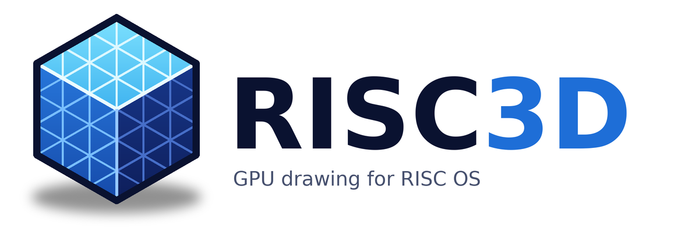
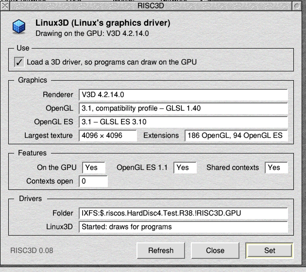
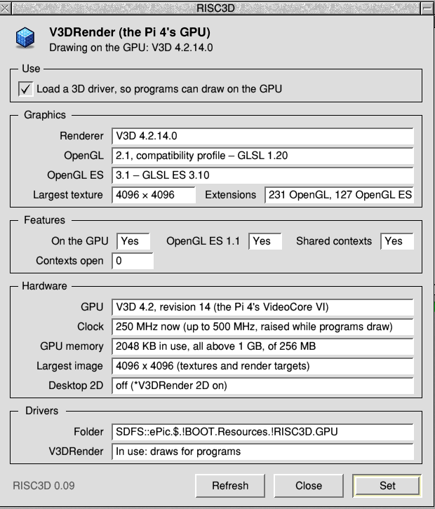

# RISC3D

A 3D driver interface for RISC OS: Mesa's front end (EGL, GLES, OpenGL)
above it, 3D drivers below it. Programs use Mesa as they do now; where a
driver is registered the drawing is done by the machine's GPU driver, and
where none is, Mesa draws in software as before.

**Release 0.16, 20 November 2026** (0.11 moved to the allocated numbers;
0.12 added contexts that share objects, for WebKit; 0.13 to 0.16 add
Configure's RISC3D window). It draws on the GPU:
- on native RISC OS on a Raspberry Pi 4, through V3DRender;
- on RISC OS on Linux, through Linux3D, on whatever GPU Linux drives. So
  far that's the Pi 4 and the Windows Dev Kit 2023.

It covers OpenGL 1.x to 3.1 and OpenGL ES 1.1 to 3.1, with riscos-mesa's
extensions. Its SWI chunk (&5AF80) and error blocks (RISC3D &823D00,
Linux3D &823C00) are allocated by RISC OS Allocations, from release
0.11.

## Installing

RISC3D is the PackMan package **RISC3D** on every system: `!RISC3D` in
`!Boot.Resources`, holding the RISC3D module and a folder `GPU` with the
drivers (each starts only on the machine it is for: Linux3D on RISC OS on
Linux; V3DRender on the Raspberry Pi 4, 400 and CM4). Its `!Boot` loads RISC3D
at start-up and RISC3D loads the first driver in `GPU` that starts, so
programs need nothing in their `!Run`. `*RISC3D` says which driver is in
use. On RISC OS on Linux, Linux's side is the Debian package
`riscos-risc3d` (`rol-3d` and Mesa 26.1.6 from trixie-backports), which
ROL's riscos-support (1.0.0068 on) brings in through Configure's Updates;
riscos-harddisc (1.0.0064 on) installs the PackMan package.

### Configure

`!RISC3DSetup`, in `!Boot.Resources.Configure`, puts **RISC3D** in
Configure. It shows:
- which driver RISC3D loaded, and whether programs draw on the GPU;
- the renderer;
- the newest OpenGL and OpenGL ES;
- the largest texture and the extensions;
- whether contexts can share objects;
- what each driver in the drivers folder did.

**Load a 3D driver** turns RISC3D's GPU drawing off or on. While it is off,
no driver is loaded and programs draw in software. The choice is kept in
`Choices:RISC3D.Settings` (`RISC3D$Off`, RISC3D 0.08 on).

On native RISC OS (a Raspberry Pi 4 with V3DRender, and !MesaLibs 20.3.5-23
for the OpenGL figures):

### For programs

Programs reach RISC3D through [riscos-mesa](https://github.com/adyoull/riscos-mesa)'s
EGL and OSMesa (!MesaLibs). They don't choose between the GPU and software:
RISC3D does, by the driver it has loaded, and with none Mesa draws in
software.

- **!MesaLibs 20.3.5-20 or later** (20.3.5-21 also carries the so/2 loader)
  has both routes: the command stream for RISC OS on Linux, and
  `libMesaGPU` (Mesa 26.1.6's v3d driver) for native RISC OS on a Pi 4.
- **On native RISC OS, a program draws on the GPU only if it is linked
  with libMesaGPU:**
  - mixed (shared) builds: `-lMesaGPU` after `-lOSMesa`;
  - static builds: `-Wl,-u,riscos_mesa_gpu -lMesaGPU` (about 15 MB more).

  Older programs, and programs without it, still work but draw in software
  there.
- **On RISC OS on Linux,** any program built against a RISC3D-aware
  riscos-mesa (20.3.5-19 on) uses the GPU. No libMesaGPU is needed.
- **In a program's !Run:** nothing is needed, since !RISC3D loads RISC3D at
  start-up. A program that must have it can check with
  `RMEnsure RISC3D 0.05 Error This program needs !RISC3D`. Never name a
  driver.
- **Contexts that share objects, in several threads** (EGL's
  `share_context`, as WebKit's Skia draws): RISC3D 0.06 and client 0.12
  on. On RISC OS on Linux this needs Linux3D 0.06 (!RISC3D 0.06-1) and
  riscos-risc3d 0.23-1 (rol-3d 0.20). On native RISC OS, sharing is done by
  riscos-mesa's own GPU driver (libMesaGPU): in test in !MesaLibs
  20.3.5-23test1.

### How riscos-mesa uses it

These are riscos-mesa's parts; its EGL-GUIDE has the details.

- **EGL:** `eglCreateContext` gives OpenGL (up to 3.1, compatibility
  profile) and OpenGL ES 1.1 to 3.1 contexts to RISC3D where it has a
  driver. OpenGL 3 and ES 3 contexts exist only through RISC3D.
  - `EGL_VERSION` says so: "1.4 riscos-mesa (OSMesa; RISC3D for OpenGL and
    OpenGL ES)".
  - `GL_VERSION` says "... RISC3D (Mesa x)" on RISC OS on Linux.
  - A program can ask for software with the context attribute
    `EGL_CONTEXT_SOFTWARE_RISCOS` (extension `EGL_RISCOS_renderer`).
  - Shared contexts and a current context per thread: through the client's
    `r3d_create_shared` and `r3d_can_share` (0.12) on RISC OS on Linux.
    riscos-mesa routes them there once it pins 0.12.
- **Window frames:**
  - **On RISC OS on Linux:** frames can go straight onto the screen
    through one of rol-fb's display planes (zero copy), in 16 million
    colour modes, with the window painted in a key colour. Otherwise they
    are copied back into the window.
  - **On native RISC OS:** the GPU draws straight into the window's
    sprite or into screen memory.
  - `EGL$SwapInterval` (0–4) overrides a program's vsync setting.
- **OSMesa:** programs that call OSMesa directly are routed to RISC3D too,
  drawing into their own buffer (`OSMESA_SOFTWARE_RISCOS` keeps one in
  software).
- **SDL:** SDL's OpenGL windows use EGL, and so RISC3D, where RISC3D has a
  driver. The hint `SDL_RISCOS_GL_EGL` set to 0 keeps SDL's own sprite path
  (software).
- **Variables:**
  - `RISC3D$Disable`: software for programs started afterwards.
  - `LIBGL_ALWAYS_SOFTWARE`: the same, Mesa's usual way.
  - `RISC3D$Force`: use the driver even where it draws in software (such
    as Linux's llvmpipe).
  - `V3DM$Stats 1`: on native RISC OS, the GPU work every 5 seconds.

Writing a driver for another GPU: see [docs/DRIVER-GUIDE.md](docs/DRIVER-GUIDE.md).

RISC3D's client library (`lib/`, `proto/`) is released as
`RISC3D-client-<version>.tgz` for riscos-mesa to build in.

### Where it runs

| System | Driver | GPU (drivers) | Tested |
|---|---|---|---|
| Native RISC OS, Raspberry Pi 4 / 400 / CM4 | V3DRender | V3D 4.2 (Mesa's v3d in riscos-mesa) | Yes |
| RISC OS on Linux, Raspberry Pi 4 | Linux3D | V3D 4.2 (Linux's v3d, Mesa's v3d) | Yes |
| RISC OS on Linux, Windows Dev Kit 2023 | Linux3D | Adreno 690 (Linux's msm, Mesa's freedreno) | Yes (Chris Gransden) |
| RISC OS on Linux, Pinebook Pro | Linux3D | Mali-T860 (Linux's panfrost, Mesa's panfrost) | Not yet |
| RISC OS on Linux, Pinebook | Linux3D | Mali-400 (Linux's lima, Mesa's lima): OpenGL ES 2.0 class | Not yet |
| Native RISC OS, i.MX6 (Wandboard, ARMX6) | EtnaRender (not yet in `GPU`) | Vivante GC2000/GC880 (Mesa's etnaviv, not yet in riscos-mesa) | Not yet: built and simulated only |
| Anything else | none | Mesa draws in software, as before | |

- **RISC OS on Linux** uses Debian's Mesa 26.1.6 from trixie-backports,
  which riscos-risc3d installs.
- **Other machines under ROL:** Linux3D hands the drawing to Linux, which
  uses whatever GPU it has. So any machine whose GPU Linux and Mesa drive
  should work.
- **The Dev Kit's GPU firmware** comes with ROL's riscos-support 1.0.0069
  and kernel 7.2.0-7.1.

### Programs seen on the GPU

| Program | Where | Notes |
|---|---|---|
| ClassiCube | Pi 4 native and ROL | about 31 fps native, 50 or more on ROL (early figures) |
| Warzone 2100 | Pi 4 native | about 28 fps (early figure) |
| YSFlight (YSCE) riscos2 | Pi 4 native | the mixed build |
| TORCS 1.3.7-riscos6 | Pi 4 native and ROL | the mixed build; on ROL it needs Mesa 26.1 (Debian's 25.0.7 loses its textures) |
| Quakespasm | Windows Dev Kit 2023, ROL | Chris Gransden's build: `timedemo demo1` 5 fps at 640x480 in software, 98 fps at 1920x1080 on the GPU |
| OpenLara | Pi 4, ROL | 50 fps, against 12 to 16 in software |

## The parts

| Part | What it is |
|---|---|
| `modules/RISC3D` | The interface module. At start-up it loads the first driver in `!RISC3D.GPU` that starts. Drivers register; a program's GL library opens a context through it. RISC3D never looks at the drawing: it keeps the drivers and contexts, closes a task's contexts when the task goes, and passes on "wake" and "wait" for command-stream drivers. |
| `modules/Linux3D` | The driver for RISC OS on Linux. Each context is a connection to the `rol-3d` helper; it maps the shared memory into RISC OS. |
| `linux/rol-3d.c` | The Linux helper: one process per context, with an EGL context on Linux's graphics driver (the GPU through its render node; Mesa's software renderer otherwise): OpenGL's compatibility profile (or, where that is older than the program asks for, the version asked for without it), GLES 2/3, or GLES 1.1 on desktop OpenGL (Debian's Mesa has none; `linux/es1*.c`). |
| `proto/` | The command stream. `gen.py` writes both ends from Khronos's registry (`khronos/gl.xml`: OpenGL 1.0 to 3.1, GLES 1.1 to 3.1, and every extension riscos-mesa has; 1189 functions, 218 of them by hand, 484 other names), and `r3d_gl.h`. `r3d_shared.h` is the shared memory's layout. |
| `lib/` | The GL functions for RISC OS programs, as commands: `r3d_glXxx`, listed by GL name (and the usual ARB/EXT names) in `r3d_gl_functions[]` so that Mesa's EGL (riscos-mesa) can build a dispatch table from them. Contexts: `r3d_create` (GLES 2 and on), `r3d_create_gl` (OpenGL), `r3d_create_es1` (GLES 1.1), `r3d_create_version` (a version at least), `r3d_target` (the program's own buffer as framebuffer 0, as OSMesa's), `r3d_driver_flags` (R3D_DRIVER_SOFTWARE: Linux draws in software), `r3d_make_current`, `r3d_destroy`; `r3d_swap` finishes a frame into a buffer. It keeps the matrix stacks and other state queried often, so those queries need no wait. `r3d_open`/`r3d_open_gl`/`r3d_close` and `R3D_DIRECT` are for the test programs. |
| `demo/test`, `demo/cube`, `demo/gl1`, `demo/es`, `demo/gl3` | `r3dtest` (GLES 2, command line, checks the pixels), `r3dcube` (the same cube in a desktop window), `gl1test` (OpenGL 1.x/2.1; built with DIRECT, the same drawn by Linux's Mesa directly, to compare; `gl1test bench`), `estest` (GLES 1.1 and GLES 2's extensions), `gl3test` (GLES 3.0/3.1, OpenGL 3.0/3.1 and EXT_direct_state_access), `targettest` (drawing into the program's buffer in OSMesa's formats; -DOSMESA: riscos-mesa's OSMesa itself). |
| `test/host` | Stand-ins so that the library and helper can be tested on the build machine without RISC OS. |
| `dist/!RISC3D` | The application in `!Boot.Resources`: !Boot, !Run, !Help, the icons, and `GPU` for the drivers. |
| `third/V3DRender` | V3DRender's released module, shipped in `!RISC3D.GPU` (GPL-2.0-or-later; source in its own repository). |
| `packaging/riscos-risc3d` | The Debian package for RISC OS on Linux: rol-3d and the Mesa pin. |
| `kit/` | The test kits' Obey files and scripts. |
| `art/`, `docs/` | The icon, logo and diagram (and the scripts that draw them); the driver guide, release notes and pictures. |

## How a frame goes

**On RISC OS on Linux (Linux3D, a command stream):**
1. The GL library writes each call as a few words into a ring in the
   shared memory. No SWI, no system call.
2. The renderer, rol-3d (another process, usually on another core), reads
   them. It's shown them in batches, and only needs waking if it has gone
   to sleep (`RISC3D_Sync` 0: one byte down a socket).
3. When the program needs an answer (a query, the end of the frame), it
   calls `RISC3D_Sync` 1 and waits. The answer is in the shared reply
   area.
4. The finished frame goes straight onto the screen through one of rol-fb's
   display planes where it can (zero copy). Otherwise it's read back and
   copied into the program's window.

**On native RISC OS (V3DRender, a DRM device):** there's no command stream.
The program's own Mesa runs its v3d driver and sends its requests to
V3DRender's ioctl SWI, as Mesa does through a DRM device on Linux. The GPU
draws straight into the window's sprite or into screen memory.

## SWIs (chunk &5AF80, allocated)

| SWI | In | Out |
|---|---|---|
| `RISC3D_Info` (&5AF80) | | r0 = version * 100, r1 = drivers, r2 = contexts, r3 -> the name of the driver a new context gets (0: none), r4 = its flags (bit 2: contexts can share objects now), r5 = its ioctl SWI and r6 -> its DRM driver name (DRM devices) |
| `RISC3D_Register` (&5AF81) | r0 = 0 add / 1 remove, r1 = entry, r2 = its r12, r3 -> name, r4 = flags (bit 0: a DRM device; bit 1: may draw in software; bit 2: can share objects), r5 = ioctl SWI, r6 -> DRM driver name | |
| `RISC3D_Open` (&5AF82) | r0 = flags (bit 0: share the objects of context r1, 0.06 on), r1 = that context | r0 = context, r1 -> shared memory, r2 = size (a DRM device: r1 = the driver's file, r2 = 0) |
| `RISC3D_Close` (&5AF83) | r0 = context | |
| `RISC3D_Sync` (&5AF84) | r0 = context, r1 = 0 wake / 1 wait | |
| `RISC3D_Describe` (&5AF85, 0.09 on) | r0 = 0, r1 -> buffer, r2 = size | r2 = size needed, r3 -> the driver's name: the driver's own lines about its GPU ("label TAB value" per line) |

A driver's entry is called with r0 = 0 open, 1 close, 2 sync, 3
describe or 4 hardware (0.09 on, drivers registered with flags bit 3). Register flags: bit 0 a DRM device; bit 1 may draw in software;
bit 2 contexts can share objects (open's r1 bit 0, with r2 the handle to
share with).
[docs/DRIVER-GUIDE.md](docs/DRIVER-GUIDE.md) has the details.

Two kinds of driver (RISC3D 0.02): a command-stream driver (Linux3D, on
RISC OS on Linux) reads the commands `lib/` writes into the shared
memory; a DRM device (flag bit 0: V3DRender, the native driver for the
Raspberry Pi 4's GPU, in its own repository) takes no command stream.
For a DRM device the program's Mesa runs its own GPU driver (Mesa's v3d)
and sends that driver's requests to the driver's ioctl SWI, with the
file RISC3D_Open returned, as Mesa does through a DRM device on Linux.
`r3d_available` is for the command stream, so it is 0 there.

## Building and testing

`RISCOS_TOOLCHAIN=.../toolchain/env ./build.sh` builds everything into
`out/`. On the build machine: `out/rol-3d-host &` then
`out/r3dtest-host 100`; `out/sharetest-host` checks contexts sharing
objects in two threads. On RISC OS on Linux: `/opt/riscos/rol-3d` (init
starts it) and !RISC3D in `!Boot.Resources` (it loads RISC3D, which loads
Linux3D), then `r3dtest` or `r3dcube`.

## Not done

- Window moves and resizes, and vsync, for RISC OS on Linux's zero-copy
  frames.
- More of GL's state kept here (enables, bound textures), and immediate
  mode packed tighter in the ring.
- glDrawElements with indices in a buffer object and arrays in the
  program's memory reads the indices back (one wait).
- Arrays in the program's memory with indirect draws are drawn as the
  direct call (the command read back); a pixel pack buffer isn't
  followed by glGetTextureSubImage, glGetCompressedTextureSubImage and
  the imaging gets (glGetnColorTable and the like).
- Speed: TORCS through Linux3D on a Pi 4 is about 24 to 30 fps. Drawing
  each object's strips in one call is TORCS's side.

## Licence

MIT (see LICENSE), Copyright (c) 2026 Andrew Youll. Included from others:
Khronos's registry `proto/khronos/gl.xml` (Apache-2.0) and the Khronos
headers in `include/` (MIT-style, as in each file); `linux/es1_conversion.c`
is ported from Mesa 20.3.5 (MIT, the Mesa authors). V3DRender, shipped in
`!RISC3D.GPU`, is GPL-2.0-or-later: its licence and notice are in
`dist/!RISC3D/GPU`, and its source is at
[riscos-v3drender](https://github.com/adyoull/riscos-v3drender).
