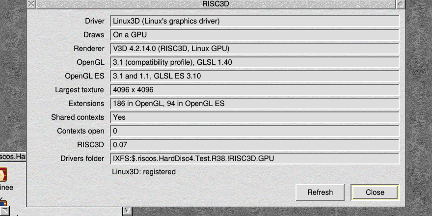

# RISC3D 0.13

Configure now has a **3D** window. It shows:

- which driver RISC3D is using;
- whether programs' 3D is drawn on the GPU or in software;
- the renderer;
- the newest OpenGL and OpenGL ES that programs can have;
- the largest texture and the number of extensions;
- whether contexts can share objects;
- the contexts open;
- what each driver in the drivers folder did.

## What's in it

- **RISC3D-0.07-1.zip:**
  - `!RISC3D`, for `!Boot.Resources`:
    - the RISC3D module 0.07;
    - in `GPU`: Linux3D 0.06 and V3DRender 0.16, as in 0.06-1.
  - `!RISC3DSetup`, for `!Boot.Resources.Configure`.

  It is also the PackMan package RISC3D.
- **RISC3D 0.07:** a drivers folder set in `RISC3D$Drivers` with a space after
  it is now found.
- Linux's side (riscos-risc3d 0.23-1) and the client library (0.12) are
  unchanged.

## Tested

On a Raspberry Pi 4 under RISC OS on Linux:
- the 3D window, started on its own;
- RISC3D 0.07;
- release 0.12's shared contexts: kit 38's `sharetest` passed on the GPU.

## Licences

- RISC3D, Linux3D, rol-3d, the client and !RISC3DSetup: MIT.
- V3DRender: GPL-2.0-or-later. Its source is at
  https://github.com/adyoull/riscos-v3drender.
