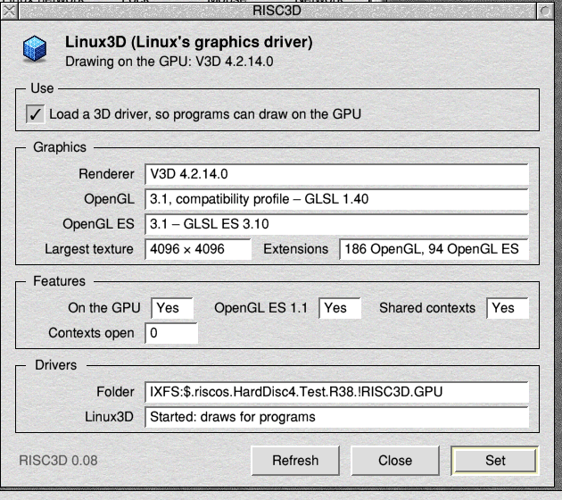

# RISC3D 0.15

Configure's **RISC3D** window can now turn RISC3D's GPU drawing off. With it off, no 3D driver is loaded and programs draw in software, as they did before RISC3D. The window has also been laid out afresh.

## What's in it

**RISC3D-0.08-2.zip** is also the PackMan package RISC3D. It holds:
- `!RISC3D`, for `!Boot.Resources`:
  - the RISC3D module 0.08;
  - in `GPU`: Linux3D 0.06 and V3DRender 0.16.
- `!RISC3DSetup` 1.03, for `!Boot.Resources.Configure`.

## Changes

- **Load a 3D driver**, the window's one tick box, with Set (the window stays open and shows the result):
  - Set keeps the choice in `Choices:RISC3D.Settings`.
  - If no program has a 3D context open, the choice takes effect at once; otherwise it takes effect at the next start.
- **RISC3D 0.08:**
  - It loads no driver while `RISC3D$Off` is set.
  - `*RMReInit RISC3D` now starts it afresh and loads the driver again.
- **The window:**
  - Groups for Graphics, Features and Drivers.
  - The driver's name in large type.
  - Yes/No fields for features, and a field for each driver.
  - Interactive help for each part.

Linux's side (riscos-risc3d 0.23-1) and the client library (0.12) are unchanged.

## Tested

On a Raspberry Pi 4 under RISC OS on Linux, run on its own:
- the window;
- turning RISC3D off and on again.

## Licences

- RISC3D, Linux3D, rol-3d, the client and !RISC3DSetup: MIT.
- V3DRender: GPL-2.0-or-later. Its source is at https://github.com/adyoull/riscos-v3drender.
