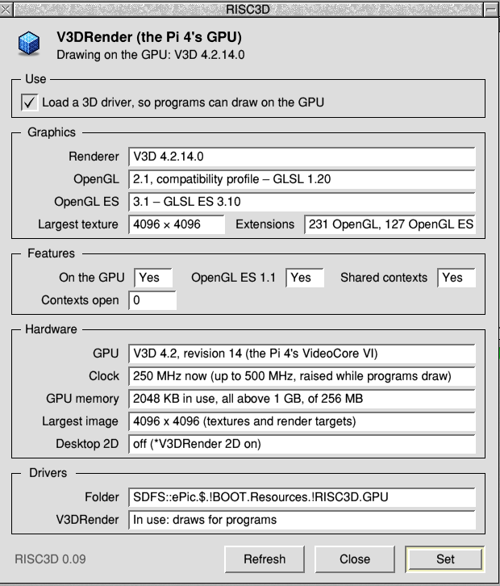

# RISC3D 0.17

Configure's **RISC3D** window now shows what the Pi 4's GPU really supports on native RISC OS, with no program running. It also gains a **Hardware** section from the driver. V3DRender, the Pi 4 driver, moves from 0.16 to **0.26**.

## What's in it

**RISC3D-0.09-1.zip** is also the PackMan package RISC3D. It holds:
- `!RISC3D`, for `!Boot.Resources`:
  - the RISC3D module 0.09;
  - in `GPU`: Linux3D 0.06 and V3DRender 0.26.
- `!RISC3DSetup` 1.05, for `!Boot.Resources.Configure`.

## Changes

### Configure's RISC3D window (!RISC3DSetup 1.05)
- **On native RISC OS** it runs riscos-mesa's GPUProbe (`<MesaLibs$Dir>.GPUProbe`, from !MesaLibs 20.3.5-23) and shows what programs get:
  - the renderer;
  - OpenGL and GLSL, and OpenGL ES and GLSL ES;
  - whether OpenGL ES 1.1 is there;
  - the largest texture and the extension counts.

  With an older !MesaLibs, it says those figures need 20.3.5-23. On RISC OS on Linux it asks Linux3D, as before.
- **A Hardware section,** with whatever the driver says about the GPU itself. From V3DRender that's the GPU and its revision, the clock, the GPU memory in use, the largest image, and whether desktop 2D is on.
- **The probe is started through the Filer, and its leftover contexts are closed.** Started by the window itself, it crashed about one time in four.

### RISC3D module 0.09
- New SWI `RISC3D_Describe` (&5AF85). It returns the driver's own lines about its GPU.
- A new driver reason, 4 "hardware", for drivers that register with flags bit 3. See docs/DRIVER-GUIDE.md.

### V3DRender 0.16 → 0.26
- **Start-up:**
  - it has the firmware power the GPU on before reading it (a likely fix for start-up aborts on some boards, such as a CM4);
  - a start-up that fails part way is cleaned up safely;
  - `V3DRender$Step` records how far start-up got.
- **For programs:**
  - imported memory follows pages the OS moves (the web browser's GPU corruption);
  - freed GPU memory is kept for reuse, up to 16 MB (`*V3DRender pool`);
  - a Broadcom cache erratum (GFXH-1897) is worked around, as Linux does.
- **Desktop 2D on the GPU, off by default** (`*V3DRender 2D on`): window moves, scrolls, block copies and plain fills. It's based on Rob Heaton's V3DDriver, then expanded through testing:
  - fills use half the GPU commands;
  - the sizes at which the GPU takes over were measured on the Pi;
  - no memory is claimed or freed during a redraw;
  - every case is checked pixel for pixel against the CPU.

  Timings on a Pi 4, native RISC OS, 1920×1200 at 32 bpp, ARM at 1800 MHz, per operation, waited for:

  | Operation | CPU | GPU | |
  |---|---|---|---|
  | Copy 512×320 | 566 µs | 266 µs | 2.1× |
  | Scroll 640×383 up a row | 666 µs | 400 µs | 1.7× |
  | Copy 256×256 | 120 µs | 110 µs | 1.1× |
  | Copy 64×64 | 25 µs | 25 µs | level |
  | Fill 640×384 | 233 µs | 233 µs | level |
  | Fill 128×128 | 35 µs | 30 µs | 1.2× |

Linux's side (riscos-risc3d 0.23-1) and the client library (0.12) are unchanged.

## Tested

On the owner's Raspberry Pi 4, native RISC OS, through TestAgent:
- the window, with !MesaLibs 20.3.5-23test3;
- 24 refreshes in a row with no crash, and no contexts left open;
- the Hardware section with V3DRender 0.20 to 0.23.

V3DRender 0.26 itself was tested by its own project. A CM4 (R-Comp Ne.X.T) report on the start-up fix is awaited.

## Licences

- RISC3D, Linux3D, rol-3d, the client and !RISC3DSetup: MIT.
- V3DRender: GPL-2.0-or-later. Its source (0.26 here) is at https://github.com/adyoull/riscos-v3drender.
