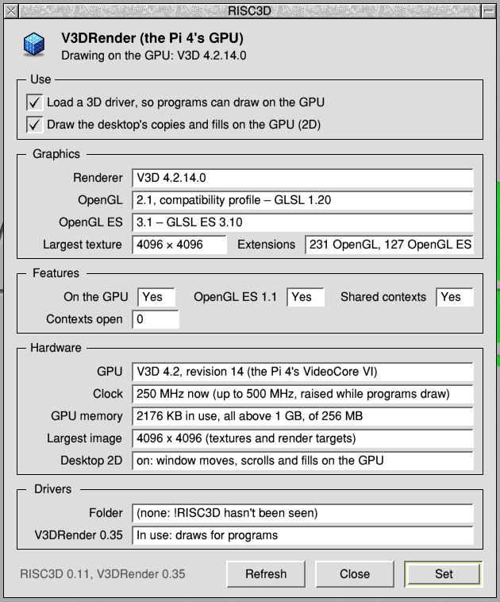

# RISC3D 0.22

A new switch in Configure's RISC3D page, for the desktop's 2D, and the 3D driver's version shown there. With them comes V3DRender 0.37, which fixes what David Sharp found porting Quake 3, Mupen64Plus and Doom 3 to RISC OS, and can put a 3D program's window on the screen by the GPU.

David's three ports run on the Pi 4's GPU through RISC3D. Quake 3 runs at 138 fps at 480x300 (35 in software). Mupen64Plus runs Super Mario 64 at 163-169 VI/s (12-15 in software). Doom 3 runs once the buffer limit is lifted.

## What's in it

**RISC3D-0.11-2.zip** is also the PackMan package RISC3D. It holds:
- `!RISC3D`, for `!Boot.Resources`:
  - the RISC3D module **0.11**;
  - **DAClamp**, run before the driver loads;
  - in `GPU`: Linux3D 0.06 and **V3DRender 0.37**.
- `!RISC3DSetup` **1.09**, for `!Boot.Resources.Configure`.

**RISC3D-client-0.13.tgz** is the client library, for building riscos-mesa.

## Changes

- **New since 0.20:**
  - **Configure's RISC3D page shows the driver's version** (for example "V3DRender 0.37") in Drivers and beside RISC3D's at the foot, so it can be told without `*Help`.
  - **The z-layer overlays tick box is gone.** Overlays behind the desktop needed an alpha desktop mode, which some programs draw wrongly in. For 3D windows, V3DRender's PRESENT now layers them under menus and windows per program, with no alpha mode. Anyone who turned it on can set `framebuffer_ignore_alpha=1` in config.txt, or put back `!Boot.Loader.CONFIG/BAK`.
  - **RISC3D 0.11:** a program's 3D contexts are closed only when it ends. Before, a GL program that ran a `*command` (`*Run`, `system()`) lost them.
  - **V3DRender 0.36:** the same fix for its GPU files.
  - **V3DRender 0.37:** PRESENT copies a frame to the screen in one pass, not two. In riscos-mesa's measurements on a Pi 4, a 1600x1000 window went from 149 to 251 frames a second, faster than the CPU copy.

The rest is as in 0.20:

- **Desktop 2D from Configure.** Where the driver offers it (V3DRender 0.28 on), the page has a tick box: "Draw the desktop's copies and fills on the GPU (2D)".
  - It's applied at once and kept, so `*V3DRender 2D on|off` isn't needed.
  - Off by default.
  - For programs: the new SWI `RISC3D_Desktop2D` (&5AF86) and the system variable `RISC3D$2D` (on, async or off).
- **V3DRender 0.37 (from 0.26):**
  - **Nothing taken at start-up.** V3DRender now takes the GPU's memory and interrupt the first time a program uses the GPU, or when the desktop's 2D is turned on. A computer that never draws on the GPU gives nothing up. Until then, Configure's RISC3D window says "none yet". The `Early` load option keeps the old way.
  - **`FreeOnly`** (in `V3DRender$Options`): take only memory nothing else is using, rather than having RISC OS move other modules' memory out of the way.
  - **A crash fixed** where the start-up log was on: its interrupt handler called RISC OS from interrupt mode (0.27 to 0.33).
  - **Doom 3 runs:** buffer tables now grow as needed (up to 65,535), where 4,096 stopped it. Refused buffers are counted in `*V3DRender`. Found by David Sharp with his dhewm3 port: he traced the crash to the handle limit and tested a fix.
  - **All its memory:** it lifts RISC OS's 128 MB limit on its buffer area itself. Before, it got 256 MB only if !MesaLibs had booted first. !RISC3D also runs its own DAClamp before the driver loads. Found by David Sharp, who worked out why his ports crashed on a machine with only !RISC3D.
  - **PRESENT:** prompted in part by David Sharp's report of tearing and slow window copies. The GPU copies a finished 3D frame into a window's visible parts, so menus and windows sit over it properly. riscos-mesa 20.3.5-24's EGL uses it: in its Pi tests a window ran at about 565 frames a second, against 66 when the CPU copied it. It works in 16 and 32 bits per pixel, RGB or BGR.
  - **`V3DRender$Options` and a longer start-up log,** for machines that stop at boot with V3DRender loading.
  - These last four came from Chris Hughes's testing on his CM4, whose logs found the crash and pointed to start-up memory.
- **Client library 0.13:** `RISC3D$Disable` works. Before, the library's test never saw the variable. Found by David Sharp with his dhewm3 port, who also spotted why RISC3D's own tests had missed it.
- **README:** programs can ask `RISC3D_Info` which driver they'll get before making a context. A program's `!Run` should load SharedUnixLibrary and ARMEABISupport. Both were David Sharp's suggestions. His three ports are in the table of programs seen on the GPU.

## Thanks

Thanks to riscos-mesa for the present measurements, to **Chris Hughes** for his patient testing on a CM4, and to **David Sharp** for his ports of ioquake3, Mupen64Plus and dhewm3, and for detailed, reproducible reports with test programs and evidence. They led to most of this release: the memory and buffer limits, the `RISC3D$Disable` fault, the documentation for programs, and riscos-mesa's fixes for 64K-colour windows and SDL video restarts. His ports are at https://github.com/davidpsharp.

## Known

- **Configure's RISC3D page can be slow to open.** Its window opens only once the GPU probe finishes, which can take up to 20 s after Set or a driver reload.

## Licences

- RISC3D, Linux3D, rol-3d, the client, DAClamp and !RISC3DSetup: MIT.
- V3DRender: GPL-2.0-or-later. Its source (0.37 here) is at https://github.com/adyoull/riscos-v3drender.
